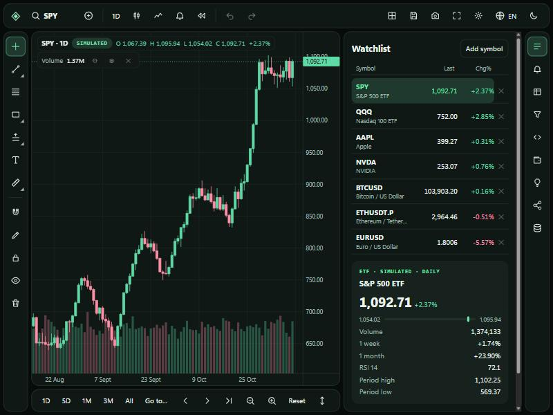

# Meridian

An open-source market charting and trading workspace that runs in the browser: charts, drawing tools, indicators, multi-chart layouts, alerts, bar replay, a screener, strategy scripts with backtesting, a simulated paper account and, when run on your own computer, your Binance futures account.

**[Open the workspace](https://mfscv.github.io/meridian/)** · [Contribute](CONTRIBUTING.md) · [Roadmap](#roadmap)



> **Crypto charts are live; everything else is simulated.** Binance spot and perpetual futures prices come straight from Binance to your browser; see [Live data](#live-data). Stocks, ETFs, forex and gold use deterministic synthetic data, so those charts work offline and carry no data-licensing obligations. Orders sent from the Binance tab are real orders on your own account. Nothing in Meridian is investment advice.

Meridian is an independent project. It is not affiliated with, endorsed by or derived from TradingView or any other charting vendor, and it contains none of their code or assets.

## What it does

| Area | Included |
| --- | --- |
| Charts | Seven chart types, nine intervals from 5 minutes to 1 week, zoom, pan, pinch, crosshair, log scale, date ranges, go to date, time zones, PNG snapshot, CSV export |
| Layouts | One to four charts with optional symbol, interval and crosshair sync; named layouts saved in the browser |
| Drawings | 18 tools: trend line, ray, extended line, arrow, horizontal line and ray, vertical line, parallel channel, rectangle, ellipse, brush, Fibonacci retracement, long and short position, text, measure, price range, date range; magnet, lock, hide, undo and redo |
| Indicators | 23 built in: volume, SMA, EMA, WMA, Bollinger Bands, Donchian and Keltner channels, Ichimoku, Supertrend, Parabolic SAR, VWAP, RSI, MACD, Stochastic, ATR, ADX, CCI, Williams %R, MFI, ROC, OBV, CMF, standard deviation; plus symbol comparison |
| Scripts | A small language for custom indicators and long-only strategies, with a backtest report and entry and exit markers. See [docs/scripting.md](docs/scripting.md) |
| Alerts | Price crossing, greater than and less than, checked in the browser on replay bars and on live prices |
| Replay | Start from any bar, play at four speeds or step bar by bar |
| Screener | Sortable table with type, direction and RSI filters |
| Paper trading | Simulated account with market, limit and stop orders, optional take-profit and stop-loss, positions and order history |
| Binance futures | With the local server: connect a USDⓈ-M futures account, see entry, break-even and liquidation prices and working orders on the chart, place market, limit, stop-loss, take-profit and trailing-stop orders, close, reverse or move the stop to break-even, set leverage and margin mode. See [docs/server.md](docs/server.md#binance-futures-account) |
| Insights | A rule-based summary of the active chart: trend, momentum, volatility and range. No AI model is involved |
| Sharing | Share links that carry the layout and drawings inside the link, a shortcut to post a chart to the project's Discussions, and workspace export and import |
| Languages | English, plus 20 machine-translated locales that still need review. See [docs/localization.md](docs/localization.md) |

It has no build step, no framework and no runtime dependencies: plain HTML, CSS and JavaScript modules, with charts drawn in SVG.

## Live data

Live data is on by default and can be turned off in Settings. Your browser connects directly to Binance's public, key-less market data services and loads spot pairs and USDⓈ-M perpetual futures (symbols ending in `.P`), then streams updates and reconnects when a stream drops. The main pairs are listed up front; symbol search finds every pair Binance lists. Live symbols are labelled "Live" wherever they appear. Alerts and working paper orders are checked against live prices as they arrive.

Meridian does not relay, store or redistribute that data, and has no agreement with Binance. Your use of the data is subject to [Binance's terms](https://www.binance.com/en/terms). The project has not found published terms that clearly grant redistribution rights for any exchange feed, which is why prices always travel from the exchange to your own browser and never through a Meridian server.

## Run it locally

You need [Node.js](https://nodejs.org/) 24 or later.

```bash
git clone https://github.com/MFSCV/meridian.git
```

```bash
cd meridian
```

```bash
npm start
```

Open `http://127.0.0.1:4173/`. The workspace is the landing page.

To run the tests:

```bash
npm ci --ignore-scripts
```

```bash
npm test
```

The files are static, so any web server can host them. The local Node server additionally provides two optional features that static hosting does not: the Official sources panel (European Central Bank reference rates and SEC EDGAR filing metadata, fetched from the publishers) and read-only connection checks for Alpaca and Interactive Brokers paper accounts. See [docs/server.md](docs/server.md).

## Using the workspace

- **Top bar:** symbol, comparison, interval, chart type, indicators, alerts, replay, layout, saved layouts, snapshot, full screen, settings, language and theme.
- **Left rail:** drawing tools. Select a tool group again to see its other tools.
- **Bottom bar:** date ranges, scroll, zoom, price scale and time zone.
- **Right rail:** one side panel at a time (watchlist, alerts, data window, screener, formulas and strategies, paper trading, insights, share and community, official sources).
- **On a chart:** drag to pan, use the wheel or pinch to zoom, double-click to reset, click a drawing to select, move or delete it.
- **Axes:** drag the price axis to stretch or compress prices and the time axis to stretch or compress time; with a manual price scale, dragging the chart also moves it up and down. Double-click the price axis, or press Auto, to return to automatic scaling.
- **Indicators:** drag the line above an indicator pane to resize it. Each indicator's legend row has settings (parameters, line colours and width, and the height of the volume bars), show or hide, and remove.
- **Drawings:** select a drawing to change its colour, width and line style from the bar that appears above the chart.
- **Customise:** Settings changes the theme, accent and candle colours, the size of controls and text, the crosshair, which toolbar buttons and side panels are shown, the side the panel sits on and whether the drawing toolbar and bottom bar are visible. Drag the edge of the side panel to resize it.
- **Keyboard:** type a letter to search symbols. On a focused chart, left and right arrows inspect bars, up and down move the price scale, `+` and `-` zoom, `Home` and `End` jump, `Delete` removes the selected drawing and `Escape` cancels. `Ctrl+Z` and `Ctrl+Y` undo and redo drawings.

Preferences, drawings, alerts, layouts and the paper account are stored in your browser only. There are no accounts: to move a workspace to another device, export it to a file from the Share and community panel and import it there. Settings → Reset preferences clears everything.

## Project layout

| File | Purpose |
| --- | --- |
| `index.html`, `style.css` | Page structure and styling |
| `app.mjs` | Workspace shell: toolbars, panels, dialogs, orders, sharing, persistence |
| `chart.mjs` | Chart engine: rendering, zoom and pan, crosshair, drawings, replay |
| `indicators.mjs` | Indicator maths and the indicator registry |
| `script.mjs` | The formula and strategy language and the backtester |
| `market.mjs` | Simulated instruments and price history |
| `live.mjs` | Live spot and futures data from Binance's public market data services |
| `broker.mjs`, `binance.mjs` | Binance futures account: the browser client and the adapter that runs in the local server |
| `i18n.mjs`, `locales/` | Translation loader and one file per locale |
| `tools/` | String extraction and locale coverage checks |
| `observed.mjs`, `feeds.mjs` | Official sources panel and its server-side adapters |
| `paper.mjs`, `server.mjs` | Paper-account connection checks and the local server |
| `*.test.mjs` | Tests, run with `node --test` |

## Roadmap

Contributions in any of these areas are welcome. Open an issue first for larger changes so the approach can be agreed.

- **Translation review.** Twenty locales are machine-translated and unreviewed. Native speakers are needed, most of all for right-to-left layout and financial terms.
- **Market data:** adapters for feeds whose terms permit display and redistribution, and stocks, forex and futures coverage.
- **Strategies:** short selling, position sizing, stops inside scripts and alerts on indicators.
- **News and calendars,** from sources with rights to republish.
- **Accounts and sync across devices,** and alerts that run when the browser is closed. Both need a server.
- **An AI assistant.** It needs a model provider and a way to pay for it; the Insights panel is rule-based.
- **Other brokers and other Binance products.** Order routing covers Binance USDⓈ-M futures only. Spot, margin, COIN-M futures and options accounts are not connected, and for Alpaca and Interactive Brokers the local server can only check that a paper account is reachable.
- **More drawing tools and indicators,** with per-drawing styling.
- **Accessibility.** The target is WCAG 2.2 AA. Controls are labelled and the chart is keyboard operable, but it has not been audited with assistive technology.

## License

[Apache License 2.0](LICENSE). See [NOTICE](NOTICE).

### Rust market engine

The simulated OHLCV engine is written in Rust under `rust/`. It generates and aggregates bars for every chart interval. The browser loads the tracked `market-engine.wasm` artifact through a small JavaScript adapter. A normal checkout can run without installing Rust.

To change or rebuild the engine, install Rust with the `wasm32-unknown-unknown` target, then run:

```sh
cargo test --manifest-path rust/Cargo.toml --locked
npm run build:rust
npm test
```

The build expects Cargo on PATH, or an absolute executable path in the CARGO environment variable. Commit the rebuilt WebAssembly artifact with the Rust source so the static and private deployments use the tested binary.

Migration status: Rust runs the synthetic market engine. The browser UI, chart interactions, indicators, strategies, live data, local API and Sites Worker still use JavaScript. HTML, CSS and locale resources continue to provide the browser presentation and copy.
